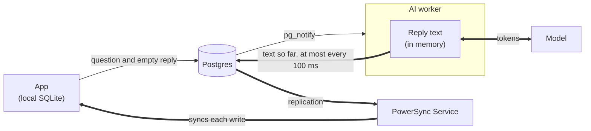
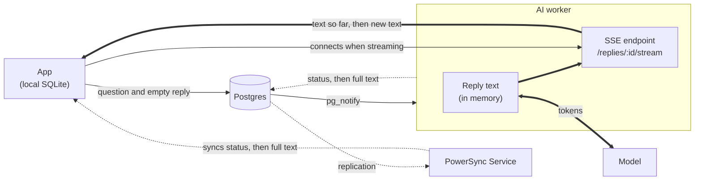

# PowerSync + Supabase: AI Chat

This demo shows two ways to stream AI chat replies to clients with PowerSync. The app looks like a typical chatbot, but the browser never calls the model. It writes the question to its local SQLite database, and an AI worker writes the reply to a synced row.

Because each reply is a database row:

- Refreshing the page mid-reply picks up where it left off.
- The reply streams to every tab and device that has the chat open.
- A question asked offline is answered after the app reconnects.

## Two streaming modes

`VITE_STREAM_MODE` in `.env.local` picks how the text reaches the app while the reply generates. Thick arrows carry the reply while it generates, and dotted arrows carry it once, when it's finished.

**Postgres mode**



**SSE mode**



|                            | `postgres` (default)                                                                                   | `sse`                                                                                   |
| -------------------------- | ------------------------------------------------------------------------------------------------------ | --------------------------------------------------------------------------------------- |
| While the reply generates  | The worker writes the text so far to the reply's row at most every 100 ms. PowerSync syncs each write. | The worker sends the text to the app over Server-Sent Events. Postgres isn't touched.   |
| When the reply is finished | The last write sets the status to `done`.                                                              | The worker writes the full text and `done` to the row once. PowerSync syncs that write. |
| Text writes per reply      | Up to 10 per second while it generates                                                                 | 1                                                                                       |
| Code                       | `worker/stream-postgres.ts`                                                                            | `worker/stream-sse.ts` and `src/components/chat/useSseReply.ts`                         |

Postgres mode is the simpler one: the database is the only channel, and PowerSync does the rest. SSE mode keeps the token stream out of Postgres, which matters when many replies generate at once. It uses a pattern some chat apps use at scale: tokens over SSE, and the database only for the finished message.

Everything else is shared:

1. `sendMessage` in `src/library/chat.ts` writes the user's message and an empty assistant message (status `pending`) in one local transaction. PowerSync uploads both to Supabase.
2. A trigger on the `messages` table calls `pg_notify`. The AI worker (`worker/index.ts`) listens for it, claims the message by setting its status to `streaming`, and generates a reply with the [AI SDK](https://ai-sdk.dev).
3. The text reaches the app in the way the mode describes.
4. The finished reply ends up in the row, and PowerSync syncs it to every client subscribed to that chat.

### Postgres mode

Writing on an interval instead of once per token keeps each reply to at most 10 writes per second, however fast the model produces tokens. The app shows the write count under each reply, and the worker logs it, for example `1601 characters in 9 writes over 2041 ms` with `STREAM_CHARS_PER_SECOND=0`. The default throttle (see below) spreads that reply over about 16 seconds, so about 160 writes. Each write syncs the whole row, so very long replies or many viewers per chat add up.

### SSE mode

The app opens an SSE connection for each reply whose synced status is `streaming`, so other tabs and devices stream it too. The Vite dev server proxies `/replies` to the worker's SSE server on port 8787. The worker keeps each reply's text in memory, and a client that connects late or reconnects first gets everything generated so far. The endpoint only serves a reply to the user who owns it, checked with their Supabase access token.

When the reply is finished, the worker writes it once and ends the SSE connections. The app keeps showing the streamed text until the saved row syncs. Because the text only lives in memory while it generates, a worker restart loses it and the reply starts over. With several workers, each chat's clients have to reach the worker generating its reply, which is the problem services like Cloudflare Durable Objects solve.

### In both modes

Some models (Gemini included) send text in a few large chunks. The worker evens this out: it sends each reply on at up to `STREAM_CHARS_PER_SECOND` (100 by default) and holds the rest until its turn, so a reply can finish a few seconds after the model does. Set it to `0` to send text as soon as the model generates it.

Each synced write or SSE event still adds a step of text, so `useSmoothText` in `src/components/chat/` reveals new text at a steady pace. Set `VITE_SMOOTH_TEXT=false` to see the steps as they arrive.

The first reply in a chat also names it: the worker asks the model for a short title and writes it to `chats.title`, and the sidebar updates through the `chats` stream.

The Sync Streams are defined in `powersync/sync-config.yaml`. The chat list is always synced, and messages are synced per chat while it is open:

```yaml
streams:
  chats:
    auto_subscribe: true
    query: SELECT * FROM chats WHERE user_id = auth.user_id()

  chat_messages:
    query: |
      SELECT * FROM messages
      WHERE chat_id = subscription.parameter('chat_id')
        AND user_id = auth.user_id()
```

The chat view in `src/app/views/chat/page.tsx` subscribes to `chat_messages` with the `streams` option of `useQuery`:

```tsx
const { data: messages } = useQuery<MessageRecord>(
  'SELECT * FROM messages WHERE chat_id = ? ORDER BY created_at',
  [chatId],
  { streams: [{ name: 'chat_messages', parameters: { chat_id: chatId } }] }
);
```

Stopping and retrying a reply are data changes too. **Stop** (or **Esc**) sets the status to `stopped`. In Postgres mode, the worker only writes while the status is `streaming`, so its next write matches no row and it cancels the model request. In SSE mode, an `assistant_reply_stopped` trigger tells the worker, which cancels the request and saves the text generated so far. **Retry** sets the status back to `pending`, which fires the first trigger again.

The demo runs against local Supabase (`supabase start`) and self-hosted PowerSync (via the PowerSync CLI). It uses anonymous Supabase auth, so there is no login screen.

## Prerequisites

- [Docker](https://docs.docker.com/get-docker/) (running)
- [Supabase CLI](https://supabase.com/docs/guides/local-development/cli/getting-started)
- [PowerSync CLI](https://docs.powersync.com/tools/cli)
- Node.js 22 or later

## Local development (recommended)

1. Switch into this demo:

   ```bash
   cd demos/react-supabase-ai-chat
   ```

2. Install dependencies:

   ```bash
   pnpm install
   ```

3. Create env file:

   ```bash
   cp .env.local.template .env.local
   ```

   The template points at the local services. For real replies, create a free Gemini API key in [Google AI Studio](https://aistudio.google.com/apikey) (no credit card needed) and set `GOOGLE_GENERATIVE_AI_API_KEY` in `.env.local`. Without a key, the worker streams a simulated reply through the same path.

4. Start local Supabase + local PowerSync:

   > Ensure the [PowerSync CLI](https://docs.powersync.com/tools/cli) is installed before running the following command.

   ```bash
   pnpm local:up
   ```

   This does three things:
   - starts Supabase Docker services and applies the migrations in `supabase/migrations`
   - starts PowerSync using the checked-in `powersync/service.yaml`
   - loads Sync Streams from `powersync/sync-config.yaml`

   Both use the default local ports (54321-54323 and 8080), so stop any other local Supabase project first.

5. Start the app and the AI worker:

   ```bash
   pnpm dev
   ```

Open [http://localhost:5173](http://localhost:5173).

## Configuration

The worker reads these settings from `.env.local`. Vite only exposes `VITE_` variables to the browser, so API keys stay on the server.

| Variable                       | Default                           | Description                                                                               |
| ------------------------------ | --------------------------------- | ----------------------------------------------------------------------------------------- |
| `AI_MODEL`                     | `google/gemini-flash-lite-latest` | Model used for replies, as `provider/model`.                                              |
| `GOOGLE_GENERATIVE_AI_API_KEY` | (empty)                           | Google Gemini API key.                                                                    |
| `ANTHROPIC_API_KEY`            | (empty)                           | Anthropic API key, for `anthropic/...` models.                                            |
| `OPENAI_API_KEY`               | (empty)                           | OpenAI API key, for `openai/...` models.                                                  |
| `VITE_STREAM_MODE`             | `postgres`                        | How replies stream: `postgres` or `sse` (see above).                                      |
| `VITE_SMOOTH_TEXT`             | `true`                            | Reveal reply text at a steady pace (see above).                                           |
| `STREAM_FLUSH_INTERVAL_MS`     | `100`                             | Postgres mode: how often the reply is written while it streams.                           |
| `STREAM_CHARS_PER_SECOND`      | `100`                             | The most characters per second the worker sends a reply at (see above). `0` turns it off. |
| `DATABASE_URL`                 | Local Supabase                    | Postgres connection the worker listens on and writes to.                                  |

To use Claude, for example, set `AI_MODEL=anthropic/claude-opus-5-5` and `ANTHROPIC_API_KEY`. To add another provider, install its [AI SDK provider package](https://ai-sdk.dev/providers/ai-sdk-providers) and register it in `worker/model.ts`.

## Database setup

The schema is in `supabase/migrations/20261016000000_init_chat.sql`. When Supabase starts for the first time, the migrations create:

- the `chats` and `messages` tables
- RLS policies that limit each user, including anonymous users, to their own chats
- the `assistant_reply_requested` trigger that notifies the worker, and the `assistant_reply_stopped` trigger that SSE mode uses
- the `powersync` publication

Run `supabase db reset` to re-apply the migrations from scratch.

## Notes

- The app signs in with `signInAnonymously()` in the connector, so each browser profile is a separate user.
- Use **Go offline** at the bottom of the sidebar to ask a question while offline.
- Keyboard shortcuts: **Esc** stops a reply, **⇧⌘O** (Ctrl+Shift+O on Windows and Linux) starts a new chat, and typing anywhere on the page goes into the message box.
- The development server includes [PowerSync DevTools](https://docs.powersync.com/tools/devtools/vite). Open the Vite DevTools dock and select **PowerSync** to watch the `messages` table change while a reply streams.
- The worker connects as the `postgres` superuser. In production, give it a role that can only read and update `messages`.
- Several workers can run at once. Each one claims a reply with a conditional `UPDATE`, so a reply is only generated once. On startup, the worker restarts replies that a previous run left `streaming`. With several workers, track which worker owns a reply instead, and in SSE mode route each client to that worker.
- To stop local services:

  ```bash
  pnpm local:down
  ```

## Learn More

- [PowerSync Sync Streams](https://docs.powersync.com/sync/streams/overview)
- [PowerSync CLI docs](https://docs.powersync.com/tools/cli)
- [AI SDK: generating and streaming text](https://ai-sdk.dev/docs/ai-sdk-core/generating-text)
- [Supabase anonymous sign-ins](https://supabase.com/docs/guides/auth/auth-anonymous)
